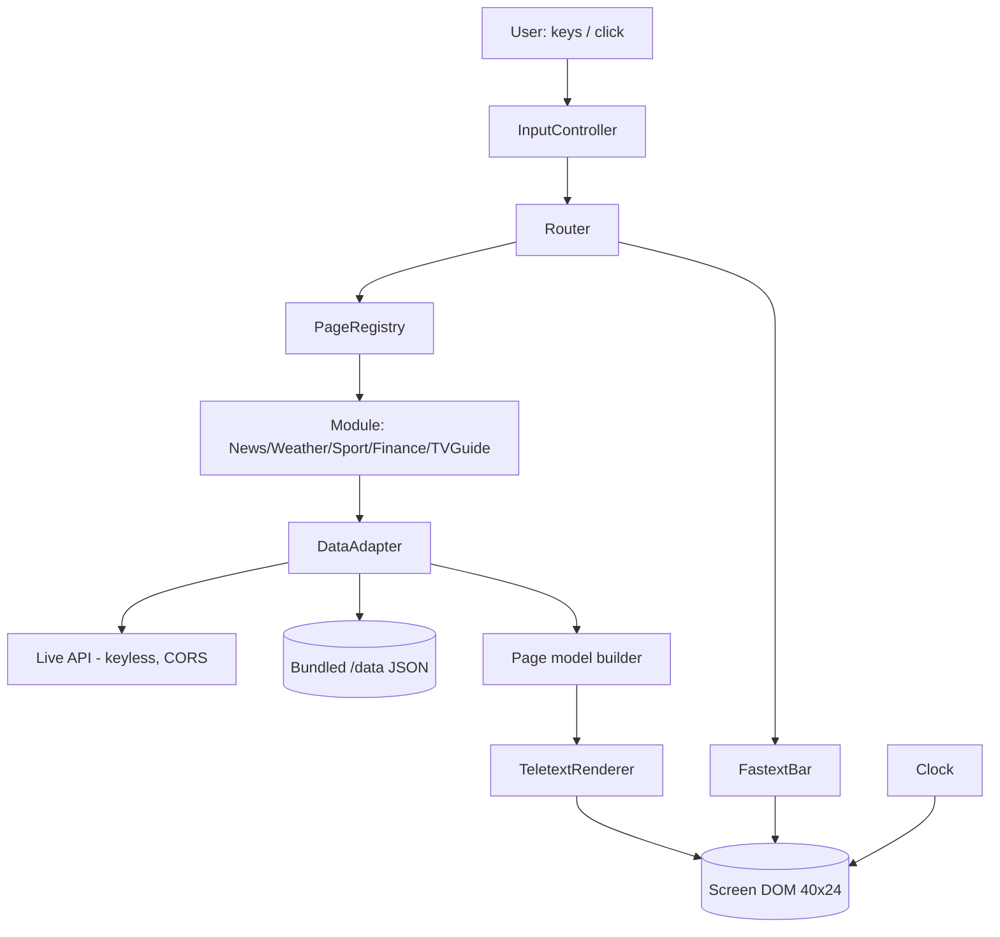
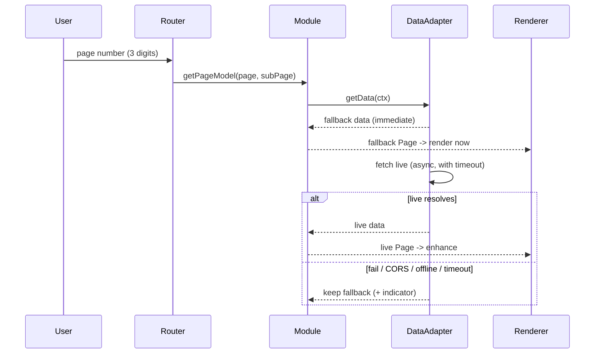
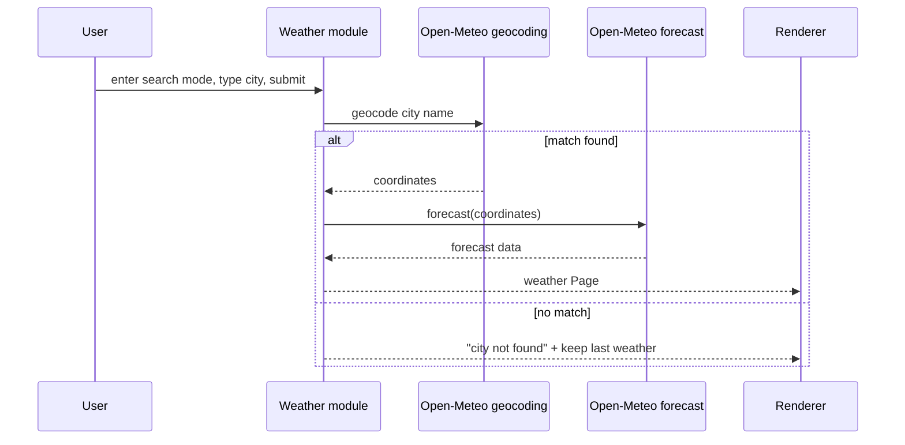

# Page 100 — Design

## Overview

Page 100 is a single-page static web app that reproduces classic Ceefax teletext in the browser. A teletext renderer draws a page model — 24 rows of 40 styled cells, including 2×3 block mosaics — onto the DOM. A page registry routes three-digit page numbers to content modules; each module uses a data adapter that tries a live keyless API and falls back to bundled JSON in `/data` so every page renders. There is no backend, no build step, no framework, and no API key.

## Goals and non-goals

Goals:
- An authentic-looking 40×24 teletext screen with the 8-color palette, double-height header, mosaics, Fastext, sub-page cycling, and a running clock.
- Five working content modules fed by live keyless data where available, always backed by fallback data.
- A pure-static, no-build, vanilla-JS app hostable on GitHub Pages.

Non-goals:
- A backend, an API key, a build step, a framework, or any runtime LLM call.
- Full historical accuracy to any one broadcaster's teletext service.
- Authoring or editing of pages by users.

## Architecture

The app is a pipeline from user input to a rendered grid. Input is parsed by an `InputController` and routed by a `Router` through a `PageRegistry` to a `Module`, whose `DataAdapter` composes live data with bundled fallback and whose builder produces a `Page` model that the `TeletextRenderer` draws into the 40×24 DOM grid. A `Clock` writes the time into the header and a `FastextBar` renders the four colored links.



## Components

### TeletextRenderer
The only component that touches the screen DOM. Takes a `Page` model and writes 24 rows × 40 cells. Rows 0–1 are the double-height header, rows 2–22 the body, row 23 the Fastext bar. Each cell is a span carrying its foreground/background color; double-height cells span two rows; mosaic cells render as a 2×3 grid of filled sub-blocks. Concentrating DOM writes here keeps grid discipline in one place.

### Page model
The data the renderer consumes (defined in Data Models). The renderer never modifies it.

### PageRegistry
Maps page numbers to page definitions: which module owns the page, its sub-page count, and its Fastext link set. Resolves the base pages 100, 200, 300, 400, 500; any other in-range number is unregistered.

### Router
Owns the current page/sub-page state. Parses three-digit entry, validates 100–899, resolves via the registry, asks the module for a `Page`, renders it, and updates the header and Fastext bar. Drives sub-page cycling with a timer that hold can pause.

### Modules
One per content area (`News`, `Weather`, `Sport`, `Finance`, `TVGuide`), each implementing the `Module` interface. A module builds a `Page` for a given page number and sub-page, using its `DataAdapter` for data and laying content out within the 40-column grid.

### DataAdapter
One per module. Tries a live, keyless, CORS-permitting fetch (with a short timeout) and always falls back to bundled `/data/*.json`. To avoid blank screens it renders fallback immediately and enhances with live data when the fetch resolves.

### Clock
Writes the current time into the right of the double-height header once per second.

### FastextBar
Renders the four colored link labels from the current page's Fastext definition into row 23; dims links with no target.

### InputController
Translates keyboard and click/touch into actions: page-number entry, color-key Fastext, hold, and the Weather module's text-entry mode.

## Data Flow

### Page load


### Weather city search


### Sub-page cycling
On a page with N sub-pages the Router holds a sub-page index shown in the header as `Pnnn/i`. A timer advances the index and re-renders every few seconds while hold is inactive; manual next/prev and hold are handled by the InputController.

## Interfaces

The code is vanilla JS; these interfaces are expressed as JSDoc types for clarity.

```js
/** One of: black, red, green, yellow, blue, magenta, cyan, white */
type Color = 'black'|'red'|'green'|'yellow'|'blue'|'magenta'|'cyan'|'white';

interface Cell {
  ch?: string;          // text character (mutually exclusive with mosaic)
  mosaic?: number;      // 6-bit 2x3 block pattern (0..63)
  fg: Color;
  bg: Color;
  dh?: boolean;         // double-height
  flash?: boolean;      // flashing
}

interface Row { cells: Cell[]; }                       // length 40
interface FastextLink { color: 'red'|'green'|'yellow'|'blue'; label: string; target: number | null; }
interface Page { rows: Row[]; fastext: FastextLink[]; }  // rows length 24

interface Module {
  id: string;
  getPageModel(page: number, subPage: number, ctx: Context): Promise<Page>;
}

interface DataAdapter {
  fetchLive(ctx: Context): Promise<Data | null>;   // null = unavailable
  loadFallback(): Data;                             // from /data/*.json
  toPageModel(data: Data, page: number, subPage: number): Page;
}
```

## Data Models

### Page model
As above: `Page` → 24 `Row`s → 40 `Cell`s. Attributes drive color, double-height, flashing, and mosaics.

### Mosaic encoding
Each mosaic character is a 6-bit value selecting which of its 2×3 sub-blocks are filled. Bit order is defined once (e.g., top-left, top-right, mid-left, mid-right, bot-left, bot-right) and reused by the renderer.

### Fallback JSON shapes (`/data/*.json`)
- `news.json` — `{ headlines: string[] }` (and optional per-story detail for sub-pages).
- `weather.json` — default-city forecast, e.g. `{ city, current: { temp, code }, forecast: [{ day, tempHi, tempLo, code }] }`.
- `sport.json` — `{ results: [{ home, away, score }] }`.
- `finance.json` — `{ rates: [{ pair, value }] }`.
- `tvguide.json` — `{ channels: [{ name, now, next }] }`.

Each module normalizes both live and fallback data to the same internal shape before `toPageModel`.

## Routing by page number

| Range | Module | Notes |
|-------|--------|-------|
| 100 | News | Headlines from Hacker News; Fastext index to 200/300/400/500 |
| 200 | Weather | Open-Meteo; searchable city; sub-pages for forecast days |
| 300 | Sport | Bundled fallback (live best-effort) |
| 400 | Finance | Keyless live rates (e.g. FX/crypto) + fallback |
| 500 | TV Guide | Bundled fallback (live best-effort) |
| 101–899 (unregistered) | — | "Page not found" screen, Fastext back to 100 |

## Error Handling

- **Fetch failure / non-OK / CORS / timeout / offline** → render bundled fallback and show the fallback indicator.
- **Invalid page number** (outside 100–899) → "page not found" screen; do not navigate.
- **Unregistered in-range number** → "page not found" screen with Fastext back to 100.
- **Weather city not found** → "city not found" message; keep the last displayed weather.
- **Slow live fetch** → render fallback immediately, enhance when live arrives (never a blank screen).

## Unit Testing Strategy

No build step, so tests run in the browser from a `tests.html` that imports the modules and runs a tiny hand-rolled assertion runner (no framework). Focus on pure functions:
- Text truncation: any string longer than the column budget is cut to fit; never exceeds 40 columns.
- Renderer invariant (property-based): for any `Page`, the renderer emits exactly 24 rows of exactly 40 cells, regardless of content.
- Page-number parsing/validation: 3-digit entry; 100–899 accepted; out-of-range rejected.
- Fallback selection: a failed/`null` live result yields the bundled fallback.
- Mosaic decoding: a given 6-bit value fills the expected sub-blocks.

Visual aspects (palette, double-height header, mosaic boxes, Fastext colors, clock, cycling) are covered by a manual visual checklist, since they are not unit-testable.

## Correctness Properties

Implemented as randomized property-based tests in `tests/properties.test.mjs` (Node's built-in test runner, seeded RNG, no dependencies — the shipped app keeps its no-build-step guarantee; the harness is dev-only).

- **P1 — Grid invariant.** For any page model produced by any module (including the not-found page), the model has exactly 24 rows and every row has exactly 40 cells.
- **P2 — Text clipping.** For any string and any start column, `putText` writes only within columns 0–39, never throws, and returns the number of characters actually written.
- **P3 — Mosaic range.** For any integer `v`, `mosaicCell(v).mosaic === v & 63` (always in 0–63), and the renderer's filled-sub-block count for any value is between 0 and 6.
- **P4 — Page-number parsing.** For any input string, `parsePageNumber` returns either `null` or an integer in [100, 899]; for any 3-digit string in range it returns that number.
- **P5 — Fallback guarantee.** For any `liveFn` that throws, rejects, or returns null, `getData` resolves to the bundled fallback with `live === false`; for any `liveFn` returning data, `getData` returns it with `live === true`.
- **P6 — Module resilience.** For any JSON-shaped garbage returned by a data source (non-string names, null scores, missing keys), every module's `getPageModel` resolves to a valid 24×40 page instead of throwing — the router's try/catch is the second line of defence, never the first.

## File Structure

```
/index.html              screen shell, links styles + entry module
/styles.css              palette, grid, font, cell aspect, flashing
/js/model.js             Page/Row/Cell types and Color set
/js/renderer.js          TeletextRenderer
/js/registry.js          PageRegistry
/js/router.js            Router + sub-page cycling
/js/clock.js             Clock
/js/input.js             InputController
/js/fastext.js           FastextBar
/js/adapter.js           DataAdapter base (fetch + fallback)
/js/modules/news.js      News + Hacker News adapter
/js/modules/weather.js   Weather + Open-Meteo adapter
/js/modules/sport.js     Sport
/js/modules/finance.js   Finance
/js/modules/tvguide.js   TV Guide
/data/news.json
/data/weather.json
/data/sport.json
/data/finance.json
/data/tvguide.json
/tests.html              no-build test runner
```

ES modules are served as-is over http(s) (e.g. GitHub Pages). The `/data` JSON is fetched from the same origin.

## Technology Stack

- Vanilla JavaScript (ES modules), no framework, no bundler, no build step.
- Static hosting (GitHub Pages or equivalent).
- Live data: Hacker News Firebase API (News), Open-Meteo forecast + geocoding (Weather), and best-effort keyless sources for Finance; Sport and TV Guide primarily bundled. All endpoints public, keyless, CORS-permitting.
- Bundled fallback JSON under `/data`.
